<p align="center">
  
</p>

<h1 align="center">Songify</h1>

<p align="center">
  Prywatny odtwarzacz muzyki — na iPhone'a, Androida (także Android Auto i tablety) i Windowsa.
</p>

<p align="center">
  <a href="https://songify.uk/dystrybucja"><b>songify.uk/dystrybucja</b></a> — strona z instalacją aplikacji
</p>

<p align="center">
  
  
  
  
  
  
  
</p>

---

> **Kod źródłowy jest prywatny.** To repozytorium jest wizytówką projektu: opisuje, czym jest Songify, jak działa i z czego jest zbudowane.
> Aplikacja jest niekomercyjna i dostępna wyłącznie z jednorazowym kluczem zaproszenia.

## Zrzuty ekranu

<p align="center">
  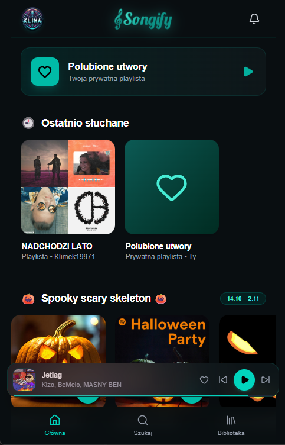
  
  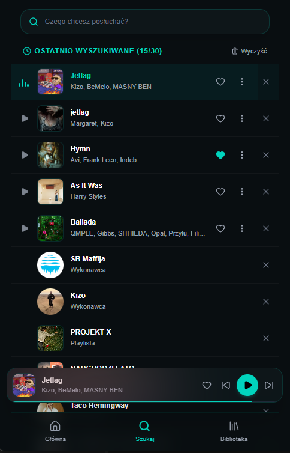
  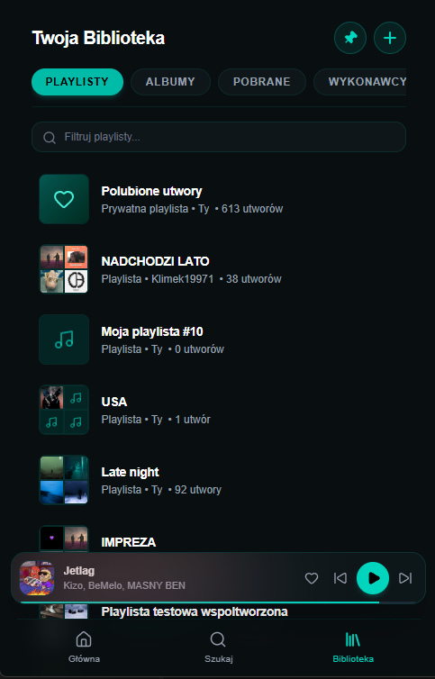
</p>

<p align="center">
  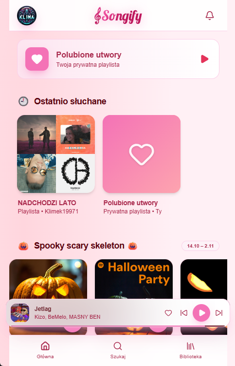
  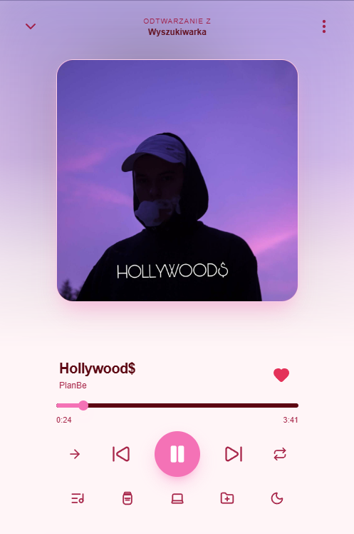
  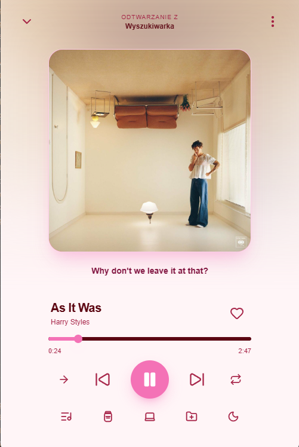
  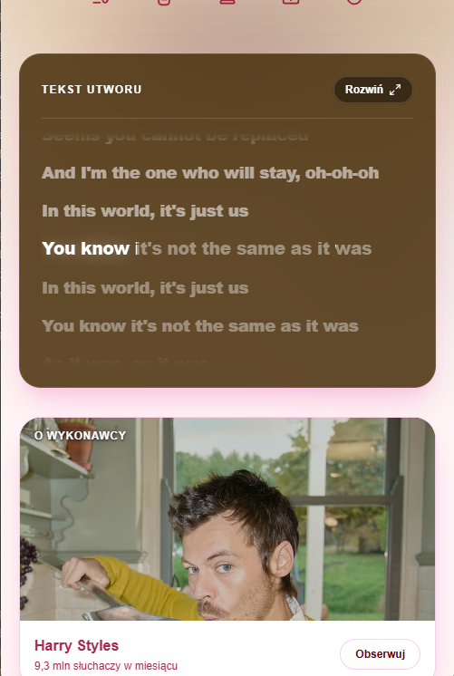
</p>

<p align="center"><b>Komputer (program na Windowsa)</b></p>

<p align="center">
  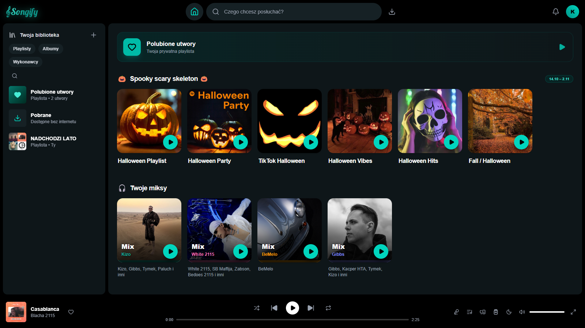
</p>

<p align="center">
  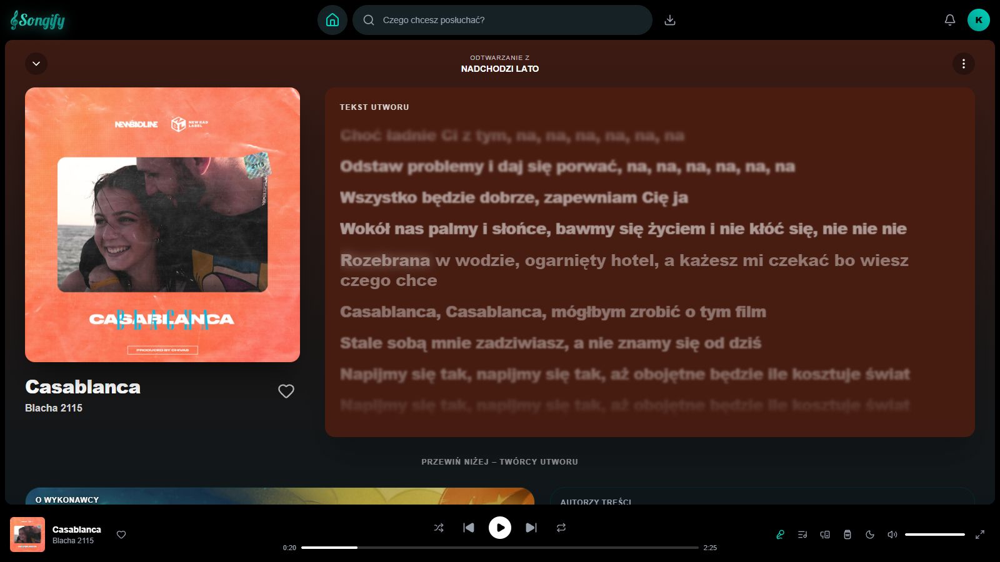
  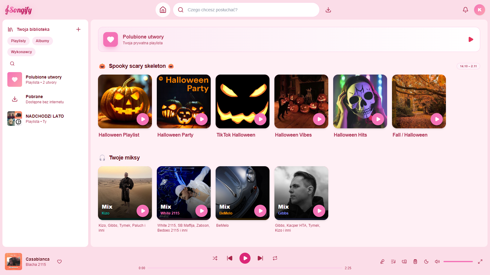
</p>

<p align="center"><b>Android Auto</b></p>

<p align="center">
  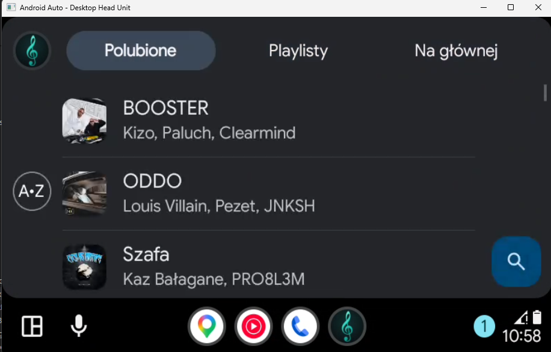
  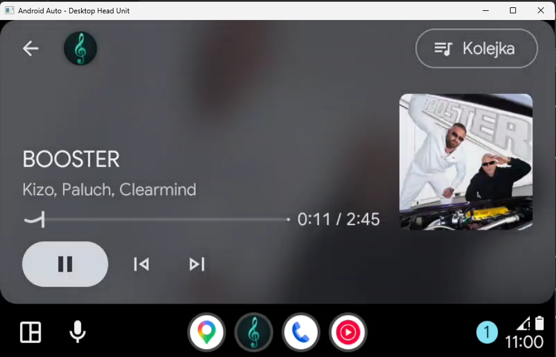
</p>

## O projekcie

Songify to aplikacja muzyczna w stylu Spotify, którą zaprojektowałem i zbudowałem od zera — od interfejsu, przez backend i bazę danych, po natywną aplikację na Androida i własny serwer. Założenia:

- **zero kosztów utrzymania** — darmowe usługi i własny serwer zamiast płatnego hostingu,
- **jedna aplikacja na wszystko** — iPhone (PWA), Android (APK z natywnym odtwarzaczem), Windows (program `.exe`),
- **wygoda jak w dużych serwisach** — szybki start utworów, odtwarzanie w tle, sterowanie z ekranu blokady, synchronizacja między urządzeniami.

## Funkcje

### 🎧 Słuchanie
- Wyszukiwarka utworów, wykonawców, albumów i playlist z podpowiedziami (np. „taco” → Taco Hemingway).
- Playlisty własne, wspólne (współtwórcy) i obserwowane, polubione, historia wyszukiwania.
- Import playlist ze Spotify (link lub plik CSV).
- Kolejka „Dodaj do kolejki”, losowanie, powtarzanie, wyłącznik czasowy.
- Teksty piosenek — zsynchronizowane z muzyką, z animacją, z możliwością własnej edycji.
- Podmiana wersji nagrania, gdy dobrane audio nie pasuje.

### ✨ Personalizacja
- **Strona główna** z topkami (Top 50 Polska, polski rap, sezonowe playlisty), miksami ulubionych wykonawców, sekcjami „Ostatnio słuchane”, „Odkryj w tym tygodniu” i „Bo słuchasz…”.
- **Proponowane dla Ciebie** — autoodtwarzanie po końcu kolejki na podstawie gustu (najmocniej liczą się ostatnio polubione utwory), ok. 70% znanych wykonawców i 30% odkrywania, bez powtórek między urządzeniami.
- **„Łapka w dół”** — odrzucony utwór nigdy więcej nie wraca w propozycjach.

### 📱 Wiele urządzeń
- **Songify Connect** — telefon steruje muzyką grającą na komputerze i odwrotnie (także z ekranu blokady, przy zgaszonym ekranie).
- **Dżem** — wspólna kolejka dla kilku osób w czasie rzeczywistym.
- Wznowienie odtwarzania na innym urządzeniu dokładnie w tym samym miejscu.

### 🖥️ Komputer i duże ekrany
- **Program na Windowsa** — własne okno z osobną głośnością w mikserze, klawisze multimedialne, ikonka w zasobniku (muzyka gra po zamknięciu okna), uruchamianie z Windowsem i automatyczne aktualizacje.
- **Układ jak w Spotify** — biblioteka z boku, wyszukiwarka u góry, odtwarzacz na dole; pełny widok utworu z dużą okładką, tekstem obok i twórcami poniżej.
- **Tablety i składane telefony** — układ dopasowuje się sam do szerokości ekranu (albo wybierasz go w ustawieniach), na dużym ekranie aplikacja obraca się do poziomu.

### 🚗 Android i Android Auto
- Natywny odtwarzacz (Media3/ExoPlayer) w usłudze w tle: karta na ekranie blokady, słuchawki, przejścia między utworami przy zgaszonym ekranie.
- **Android Auto** — katalog w samochodzie (Polubione, Playlisty, Na głównej), odtwarzanie z kolejką, przejęcie stanu przez aplikację na telefonie.

### 📥 Offline
- Pobieranie playlist i albumów na telefon/komputer z paskiem postępu i dokańczaniem przerwanych pobrań.
- Tryb „tylko pobrane” — aplikacja uruchamia się i gra bez internetu.

## Architektura

```
 iPhone (PWA)     Android (APK)     Windows (Electron)
      \                |                 /
       \     Capacitor + Media3         /
        \              |               /
         ─────── Cloudflare Tunnel ─────
                       |
        Własny serwer: telefon z Androidem
        (Termux + Ubuntu, Next.js w trybie produkcyjnym)
          ├─ pamięć podręczna audio na dysku (do 50 GB, LRU)
          ├─ pobieranie w tle bibliotek i topek
          └─ logi diagnostyczne z urządzeń
                       |
        Supabase: Postgres + Auth + Realtime
```

- **Frontend:** Next.js 16 (App Router), React 19, TypeScript, Tailwind CSS 4, Zustand.
- **Backend:** Route Handlers i Server Actions w Next.js, Prisma, Supabase (Postgres z Row Level Security, logowanie, kanały Realtime dla Connect i Dżemu).
- **Windows:** Electron — program wczytuje aplikację z serwera (nowe funkcje bez reinstalacji), a sam aktualizuje się przez electron-updater.
- **Android:** Capacitor 8 + własne natywne moduły w Javie — usługa odtwarzania Media3 (`MediaLibraryService`), obsługa Android Auto, Connect działający przy uśpionej stronie, pliki offline.
- **Hosting za 0 zł:** serwer działa na starym telefonie z Androidem w domu, wystawiony przez Cloudflare Tunnel pod własną domeną. Z autostartem, automatycznymi restartami i rotacją logów.
- **Wydajność:** utwory, które ktoś już słuchał, serwer trzyma na dysku i podaje w ok. 0,3 s; nowe utwory z bibliotek użytkowników pobiera spokojnie w tle, zanim ktokolwiek je kliknie.
- **Metadane:** okładki i informacje o utworach z Deezer i Spotify, teksty z LRCLIB.

## Instalacja

Wszystkie wersje są na **[songify.uk/dystrybucja](https://songify.uk/dystrybucja)**:

| Platforma | Sposób |
|---|---|
| Android | plik APK do pobrania (z obsługą Android Auto) |
| iPhone | Safari → Udostępnij → „Do ekranu początkowego” |
| Windows | program `songify-setup.exe` (Mac / Linux: Chrome lub Edge → „Zainstaluj aplikację”) |

Do założenia konta potrzebny jest **klucz zaproszenia** — Songify jest prywatną aplikacją dla znajomych.

## Autor

**Dawid Klimczuk** — cały projekt od zera: projekt UI/UX, frontend (PWA), backend i baza danych, natywna aplikacja na Androida z Android Auto, program na Windowsa oraz własny serwer.

© 2026 Dawid Klimczuk. Wszelkie prawa zastrzeżone — kod źródłowy i projekt interfejsu są moją własnością i nie są udostępniane.

Songify to prywatny, niekomercyjny projekt, niepowiązany z innymi aplikacjami o podobnej nazwie.
